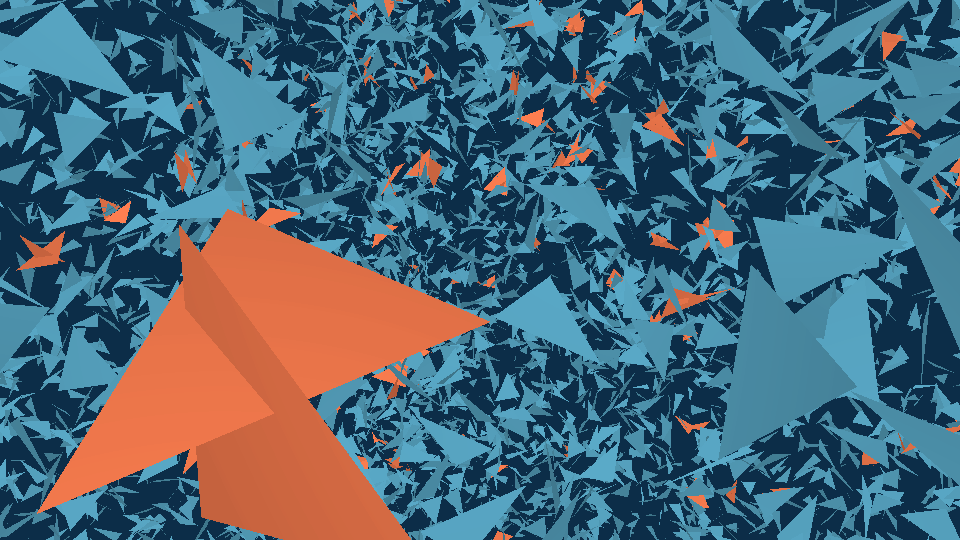

<h1 align="center">Triangles</h1>

<p align="center">
  Поиск пересекающихся треугольников в 3D с точной арифметикой и OpenGL-визуализацией сцены
</p>

<p align="center">
  
  
  
</p>

---

<p align="center">
  
</p>

Программа получает на вход набор треугольников в пространстве и находит все, которые пересекаются хотя бы с одним другим. Визуализация показывает сцену в окне OpenGL и выделяет пересекающиеся треугольники цветом; по сцене можно свободно летать камерой. Консольная версия печатает номера пересекающихся треугольников.

- Касание вершиной или ребром считается пересечением.
- Вырожденные треугольники — точки и отрезки — обрабатываются наравне с обычными.
- Все решения принимаются по знакам **точных** геометрических предикатов, поэтому ответ не зависит от ошибок округления.

## Содержание

- [Быстрый старт](#быстрый-старт)
- [Использование](#использование)
- [Геометрия](#геометрия)
  - [Постановка задачи](#постановка-задачи)
  - [Точные предикаты для определения пересечений](#точные-предикаты-для-определения-пересечений)
  - [Пересечение двух треугольников](#пересечение-двух-треугольников)
  - [Поиск пересекающихся треугольников](#поиск-пересекающихся-треугольников)
- [Визуализация](#визуализация)
  - [Управление](#управление)
  - [Цветовые темы](#цветовые-темы)
  - [Как устроена отрисовка](#как-устроена-отрисовка)
- [Тестирование](#тестирование)
- [Структура проекта](#структура-проекта)

## Быстрый старт

> [!NOTE]
> Проект сделан под Windows в среде [MSYS2](https://www.msys2.org/) UCRT64.

Требования:

| Что | Версия | Зачем |
|---|---|---|
| Компилятор GCC | с поддержкой C++20 | сборка |
| [CMake](https://cmake.org/) | 3.16+ | сборка, загрузка зависимостей |
| [Ninja](https://ninja-build.org/) | любая | генератор сборки |
| Python 3 + Jinja2 | любая | генерация загрузчика OpenGL ([glad](https://github.com/Dav1dde/glad)) |
| Видеокарта | OpenGL 3.3 core | окно визуализации |

Установка инструментов в терминале MSYS2 UCRT64:

```bash
pacman -S mingw-w64-ucrt-x86_64-gcc mingw-w64-ucrt-x86_64-cmake mingw-w64-ucrt-x86_64-ninja mingw-w64-ucrt-x86_64-python-jinja2
```

Библиотеки (GLFW, glad, GLM, GoogleTest) подтягиваются автоматически при первой конфигурации.

Сборка:

```bash
git clone https://github.com/andreyphm/triangles.git
cd triangles
cmake -S . -B output
cmake --build output
```

## Использование

Консольная версия:

```powershell
cmd /c ".\output\cli\triangles_cli.exe < examples\cloud_5k.in"
```

Визуализация (можно выбрать [цветовую тему](#цветовые-темы)):

```powershell
cmd /c ".\output\triangles.out.exe [--theme ...] < examples\cloud_5k.in"
```

> [!TIP]
> В PowerShell нет перенаправления ввода `<`, а конвейер `Get-Content файл | программа` портит ввод. Поэтому запуск идёт через `cmd /c`. В терминале MSYS2 можно писать как обычно: `./output/triangles.out < examples/cloud_5k.in`.

### Формат ввода

Первое число — количество треугольников `N`, `0 < N < 1'000'000`. Затем `N` треугольников по 9 координат: три вершины по `x y z`. Переводы строк произвольные.

```text
3
0 0 0  1 0 0  0 1 0
1 0 0  2 0 0  1 1 1
5 5 5  6 5 5  5 6 5
```

### Формат вывода

**Консольная версия** печатает номера пересекающихся треугольников — с нуля, по возрастанию, по одному в строке. Для примера выше первые два треугольника касаются вершиной `(1, 0, 0)`, третий лежит отдельно:

```text
0
1
```

**Визуализация** печатает версию OpenGL и открывает окно со сценой, в котором пересекающиеся треугольники выделены цветом.

Если ввод ошибочный — нечисловое значение, `N` вне диапазона, треугольников меньше, чем заявлено, — обе программы печатают сообщение в поток ошибок и завершаются с кодом `1`. Визуализация также завершается, если передан неизвестный аргумент или имя темы, и печатает подсказку.

### Примеры сцен

В [`examples/`](examples) лежат случайные сцены:

| Файл | Треугольников | Что внутри |
|---|---:|---|
| `cloud_5k.in` | 5 000 | сцена размером ~40, треугольники близкого размера ~1 |
| `mixed_sizes_10k.in` | 10 000 | сцена ~75, треугольники от ~0.1 до ~4 |
| `tiny_cloud_20k.in` | 20 000 | очень маленькие координаты: сцена ~0.1 |
| `huge_cloud_50k.in` | 50 000 | очень большие координаты: сцена ~10⁶ |

Свои сцены можно сгенерировать скриптом [`tools/generate_scene.py`](tools/generate_scene.py). Центры треугольников случайно разбрасываются по кубу `[0, SIZE]³`, а каждая вершина отстоит от центра не больше чем на размер треугольника по каждой оси:

```bash
python tools/generate_scene.py --count 5000 --scene-size 100 --triangle-size 1 3 --seed 1 --output examples/my_scene.in
```

| Аргумент | Смысл |
|---|---|
| `--count` | число треугольников, от 1 до 999 999 |
| `--scene-size` | ребро куба, в котором лежат центры треугольников |
| `--triangle-size` | размеры треугольников: одно число или диапазон `MIN MAX` |
| `--seed` | зерно генератора случайных чисел, по умолчанию `1` |
| `--output` | файл, в который записывается сцена |

## Геометрия

### Постановка задачи

Треугольник понимается как замкнутая фигура: граница вместе с внутренностью. Два треугольника пересекаются, если у них есть хотя бы одна общая точка.

Три вершины не обязаны образовывать настоящий треугольник:

- если все три вершины совпадают, треугольник — **точка**;
- если вершины лежат на одной прямой, треугольник — **отрезок**;
- иначе это **невырожденный треугольник**, т.е. треугольник в классическом понимании.

### Точные предикаты для определения пересечений

Реализация: [`geometry/source/robust_predicates.cpp`](geometry/source/robust_predicates.cpp).

Всё распознавание пересечений построено на одном вопросе: *с какой стороны лежит точка?*

- **`orient3d(a, b, c, d)`** — с какой стороны от плоскости, проходящей через `a`, `b`, `c`, лежит точка `d`?
- **`orient2d(a, b, c)`** — то же на плоскости: с какой стороны от прямой `ab` лежит точка `c`?

Ответ — знак определителя: `+`, `-` или `0`. Для `orient3d`:

$$
\mathrm{orient3d}(a, b, c, d) = \mathrm{sign}
\begin{vmatrix}
a_x - d_x & a_y - d_y & a_z - d_z \\
b_x - d_x & b_y - d_y & b_z - d_z \\
c_x - d_x & c_y - d_y & c_z - d_z
\end{vmatrix}
$$

Ноль означает, что четыре точки лежат в одной плоскости.

Определитель, посчитанный в `double`, содержит ошибку округления, и рядом с нулём она может дать `+` или `-` вместо `0` — а ноль и есть касание. Ранняя версия проекта считала в обычном `double` и на касаниях с большими координатами примерно в 9% случаев отвечала «не пересекаются»; эти входы закреплены в регрессионных тестах.

#### Как считается знак

Подход взят из работы Дж. Шевчука [*Adaptive Precision Floating-Point Arithmetic and Fast Robust Geometric Predicates*](https://www.cs.cmu.edu/~quake/robust.html).

1. **Быстрый путь.** Определитель считается в `double` и сравнивается с гарантированной верхней оценкой ошибки округления. Оценка пропорциональна сумме модулей слагаемых определителя. Если модуль результата больше оценки, знак не может быть искажён. На реальных данных это почти все вызовы.
2. **Точный путь.** Иначе определитель пересчитывается без округлений. Число записывается как точная сумма нескольких `double`, которые не перекрываются по разрядам. Сумму и произведение двух `double` можно записать точно как пару «округлённый результат + его ошибка», и из таких пар собирается весь определитель. Знак такой суммы равен знаку её самого большого по модулю слагаемого.

Знак получается точным для любых конечных координат. Бесконечность и `NaN` в аргументах считаются ошибкой.

> [!IMPORTANT]
> Точный путь опирается на то, что каждая операция округляется ровно так, как записана. Поэтому файл предикатов собирается со строгой плавающей точкой (`-ffp-contract=off`, `-fno-fast-math`): компилятору запрещено сливать умножение со сложением и переставлять операции.

### Пересечение двух треугольников

Реализация: [`geometry/source/intersection.cpp`](geometry/source/intersection.cpp).

#### Классификация

Сначала определяется тип каждого треугольника: точка, отрезок или невырожденный треугольник.

Дальше пара фигур сводится к одному из шести случаев:

|  | Точка | Отрезок | Треугольник |
|---|:---:|:---:|:---:|
| **Точка** | совпадение | точка на отрезке | точка в треугольнике |
| **Отрезок** | | отрезок и отрезок | отрезок и треугольник |
| **Треугольник** | | | треугольник и треугольник |

#### Точка

- **Точка и точка** пересекаются, если совпадают все координаты.
- **Точка на отрезке:** точка лежит на прямой, проходящей через концы отрезка (проверяется по трём проекциям), и по каждой координате находится между концами.
- **Точка в треугольнике:** точка лежит в плоскости треугольника (`orient3d = 0`). Затем треугольник и точка проецируются на ту координатную плоскость, где проекция треугольника не вырождена. Точка внутри или на границе, если относительно трёх рёбер она не оказывается одновременно слева от одного и справа от другого.

#### Отрезок и отрезок

1. Четыре конца должны лежать в одной плоскости, иначе отрезки скрещиваются и общих точек нет.
2. Отрезки проецируются на три координатные плоскости, и пересечение должно найтись **в каждой** проекции.

Пересечение двух отрезков на плоскости:

- концы каждого лежат строго по разные стороны от прямой другого — отрезки пересекаются крестом;
- иначе пересечение есть только в том случае, если какой-то из концов одного отрезка лежит на другом.

#### Отрезок и треугольник

Решение зависит от того, где концы отрезка относительно плоскости треугольника:

| Концы отрезка | Что проверяется |
|---|---|
| строго по одну сторону | пересечения нет |
| строго по разные стороны | отрезок пересекает плоскость в одной точке. Она внутри треугольника, если прямая отрезка проходит «внутри» относительно каждого из трёх рёбер, т.е. три вызова `orient3d` не дают разных ненулевых знаков |
| один конец на плоскости | этот конец — единственная общая точка с плоскостью; проверяется, лежит ли он в треугольнике |
| оба конца на плоскости | отрезок расположен полностью внутри треугольника или пересекает одно из его рёбер |

#### Треугольник и треугольник

1. Для каждой вершины второго треугольника определяется, с какой стороны она от плоскости первого. Если все три строго по одну сторону, плоскость разделяет треугольники — пересечения нет. Так же проверяются вершины первого относительно плоскости второго.
2. Иначе треугольники пересекаются тогда и только тогда, когда **какое-то ребро** одного треугольника пересекает другой треугольник. Каждое ребро проверяется как случай «отрезок и треугольник».

### Поиск пересекающихся треугольников

Реализация: [`geometry/source/intersection_search.cpp`](geometry/source/intersection_search.cpp), [`geometry/source/uniform_grid.cpp`](geometry/source/uniform_grid.cpp).

Проверить все пары — это `N(N−1)/2` точных проверок: для `N = 100 000` около пяти миллиардов. Но пересекаться могут только треугольники, которые лежат рядом. Поэтому в проекте поиск идёт в два этапа: сначала дёшево отбираются близкие пары-кандидаты, и только для них выполняется точная проверка.

#### Ограничивающие параллелепипеды

Для каждого треугольника один раз строится наименьший содержащий его параллелепипед со сторонами вдоль осей. Если параллелепипеды двух треугольников не пересекаются, то не пересекаются и сами треугольники. Такая проверка — шесть сравнений чисел, она намного дешевле точной.

#### Равномерная сетка

Пространство делится на одинаковые кубические ячейки. Каждый треугольник записывается во все ячейки, которые задевает его параллелепипед.

Если два треугольника пересекаются,то их параллелепипеды тоже пересекаются, значит, у них есть общая ячейка. Поэтому достаточно сравнивать только треугольники из одной ячейки.

Размер ячейки подбирается по сцене:

- начальный размер — средний размер параллелепипеда, чтобы типичный треугольник занимал несколько ячеек;
- по каждой оси сцена делится не больше чем на `2²¹ − 1` ячеек, чтобы три номера ячейки помещались в одно 64-битное число — ключ ячейки.
- пока записей в ячейки больше, чем 16 на треугольник, размер ячейки удваивается. Иначе один огромный треугольник занял бы миллионы ячеек.

#### Обход

**Опорная ячейка:** Пара может делить несколько ячеек, но точно проверять её нужно один раз. Поэтому пара проверяется только в одной из общих ячеек — в той, где лежит точка пересечения двух параллелепипедов с наименьшими координатами.

1. Все записи «ячейка — треугольник» сортируются по ключу ячейки, и треугольники одной ячейки оказываются рядом.
2. В каждой ячейке перебираются пары её треугольников. Проверки идут от дешёвых к дорогим:
   - оба треугольника уже отмечены как пересекающиеся — пара пропускается, новой информации она не даст;
   - параллелепипеды не пересекаются — пропускается;
   - ячейка не опорная для этой пары — пропускается;
   - иначе выполняется точная проверка.
3. Когда отмечены все треугольники, поиск завершается досрочно.

> [!NOTE]
> Когда треугольники мелкие и разбросаны по сцене, в каждой ячейке их немного, и время поиска растёт почти линейно с `N`. Худший случай остаётся квадратичным: много крупных треугольников, которые лежат рядом, но не пересекаются, попадают в одни и те же ячейки.

## Визуализация

Окно показывает всю сцену: обычные и пересекающиеся треугольники рисуются двумя разными цветами текущей темы. Камера свободно летает по сцене.

### Управление

| Клавиша | Действие |
|---|---|
| <kbd>W</kbd> / <kbd>S</kbd> | вперёд / назад по направлению взгляда |
| <kbd>A</kbd> / <kbd>D</kbd> | влево / вправо |
| <kbd>Space</kbd> / <kbd>Shift</kbd> | вверх / вниз |
| <kbd>Ctrl</kbd> | ускорение ×2, пока зажат |
| Колёсико мыши | скорость полёта: вверх — быстрее, вниз — медленнее |
| Мышь | поворот взгляда |
| <kbd>Alt</kbd> | показать курсор, пока зажат |
| <kbd>←</kbd> / <kbd>→</kbd> | предыдущая / следующая цветовая тема |
| <kbd>Esc</kbd> | закрыть окно |

### Цветовые темы

Реализация: [`graphics/headers/theme.hpp`](graphics/headers/theme.hpp).

Тема задаёт три цвета: фон, обычные треугольники и пересекающиеся. Начальная тема выбирается аргументом `--theme`, по умолчанию — `ocean`. В окне темы переключаются стрелками по кругу.

Скриншот темы открывается по клику на её имя:

| Тема | Фон | Треугольники | Пересекающиеся |
|---|---|---|---|
| [`ocean`](assets/ocean_theme.png) | `#0C2D48` | `#5AAAC8` | `#FF7F50` |
| [`pine`](assets/pine_theme.png) | `#1E4637` | `#96C3A0` | `#FF6E5A` |
| [`ultraviolet`](assets/ultraviolet_theme.png) | `#230A46` | `#BE6EFF` | `#5FEC5F` |
| [`desert`](assets/desert_theme.png) | `#EEE2C8` | `#C8AA78` | `#285AC8` |

### Как устроена отрисовка

#### Подготовка сцены

Реализация: [`scene/source/vertices.cpp`](scene/source/vertices.cpp).

Видеокарта работает с `float`, а координаты на входе — `double` и могут быть любого масштаба: от `0.1` до `10⁶` и больше. Поэтому сцена сначала в `double` сдвигается в начало координат и масштабируется в куб `[-0.5, 0.5]`, и только потом переводится во `float`. Так мелкие детали далёкой от нуля сцены не теряются из-за точности `float`.

#### Данные на видеокарте

Реализация: [`graphics/source/gpu_triangles.cpp`](graphics/source/gpu_triangles.cpp).

Вершины загружаются на видеокарту один раз. Для каждой вершины хранятся только координаты и признак, пересекается ли треугольник. Цвета передаются шейдеру отдельно. Весь кадр рисуется одним вызовом.

#### Освещение

Реализация: [`graphics/shaders/triangles_fragment.glsl`](graphics/shaders/triangles_fragment.glsl).

Шейдер вычисляет нормаль в каждой точке по тому, как меняется её положение между соседними пикселями. Яркость зависит от угла между нормалью и направлением на камеру:

$$
\text{яркость} = 0.65 + 0.35 \cdot |\cos \alpha|
$$

Модуль косинуса означает, что обе стороны треугольника освещаются одинаково.

#### Камера

Реализация: [`graphics/source/camera.cpp`](graphics/source/camera.cpp).

Перспективная камера с углом обзора 60°. Камера стартует снаружи сцены и смотрит на её центр. Наклон взгляда ограничен ±89°, чтобы камера не переворачивалась через вертикаль.

#### Окно

Реализация: [`graphics/source/window.cpp`](graphics/source/window.cpp).

Окно и контекст OpenGL создаёт [GLFW](https://www.glfw.org/), функции OpenGL загружает [glad](https://github.com/Dav1dde/glad). Поддерживается перерисовка сцены во время растягивания окна. Тексты шейдеров при сборке вклеиваются в программу, поэтому исполняемый файл не зависит от папки, из которой его запустили.

## Тестирование

Тесты используют [GoogleTest](https://github.com/google/googletest) и запускаются через [CTest](https://cmake.org/cmake/help/latest/manual/ctest.1.html) после сборки:

```bash
ctest --test-dir output --output-on-failure
```

Запуск одной группы — `geometry`, `scene`, `graphics` или `e2e` (консольная версия на файлах ввода):

```bash
ctest --test-dir output -L geometry
```

## Структура проекта

```text
.
├── CMakeLists.txt                      # корневая сборка, GoogleTest
├── main.cpp                            # визуализация
├── cmake/
│   └── warnings.cmake                  # общие флаги предупреждений
├── geometry/
│   ├── CMakeLists.txt
│   ├── headers/
│   │   ├── vector2.hpp                 # вектор на плоскости
│   │   ├── vector3.hpp                 # вектор и точка в пространстве
│   │   ├── triangle.hpp                # треугольник
│   │   ├── bounding_box.hpp            # ограничивающий параллелепипед
│   │   ├── robust_predicates.hpp       # точные предикаты orient2d, orient3d
│   │   ├── intersection.hpp            # пересечение двух треугольников
│   │   ├── uniform_grid.hpp            # равномерная сетка для отбора кандидатов
│   │   ├── intersection_search.hpp     # поиск всех пересекающихся треугольников
│   │   └── input_reader.hpp            # чтение ввода
│   ├── source/
│   │   ├── triangle.cpp
│   │   ├── bounding_box.cpp
│   │   ├── robust_predicates.cpp
│   │   ├── intersection.cpp
│   │   ├── uniform_grid.cpp
│   │   ├── intersection_search.cpp
│   │   └── input_reader.cpp
│   └── tests/
│       ├── CMakeLists.txt
│       ├── vector3_tests.cpp
│       ├── triangle_tests.cpp
│       ├── bounding_box_tests.cpp
│       ├── predicates_tests.cpp
│       ├── intersection_tests.cpp
│       ├── uniform_grid_tests.cpp
│       ├── intersection_search_tests.cpp
│       └── input_reader_tests.cpp
├── cli/
│   ├── CMakeLists.txt
│   ├── main.cpp                        # консольная версия
│   └── tests/
│       ├── CMakeLists.txt
│       ├── run_e2e.cmake               # запуск triangles_cli и сверка ответа
│       └── data/                       # пары *.in / *.out
├── scene/
│   ├── CMakeLists.txt
│   ├── headers/
│   │   └── vertices.hpp                # подготовка вершин сцены для отрисовки
│   ├── source/
│   │   └── vertices.cpp
│   └── tests/
│       ├── CMakeLists.txt
│       └── vertices_tests.cpp
├── graphics/
│   ├── CMakeLists.txt                  # GLFW, glad, GLM
│   ├── headers/
│   │   ├── window.hpp                  # окно и ввод
│   │   ├── shader_program.hpp          # шейдерная программа
│   │   ├── shaders.hpp                 # исходники шейдеров
│   │   ├── vertex.hpp                  # вершина: координаты и признак пересечения
│   │   ├── gpu_triangles.hpp           # буферы вершин на видеокарте
│   │   ├── camera.hpp                  # камера
│   │   └── theme.hpp                   # цветовые темы
│   ├── source/
│   │   ├── window.cpp
│   │   ├── shader_program.cpp
│   │   ├── shaders.cpp
│   │   ├── gpu_triangles.cpp
│   │   ├── camera.cpp
│   │   └── theme.cpp
│   ├── shaders/
│   │   ├── triangles_vertex.glsl       # вершинный шейдер
│   │   ├── triangles_fragment.glsl     # фрагментный шейдер
│   │   └── shader_sources.hpp.in       # шаблон заголовка с текстом шейдеров
│   └── tests/
│       ├── CMakeLists.txt
│       └── camera_tests.cpp
├── tools/
│   └── generate_scene.py               # генератор случайных сцен
├── assets/                             # скриншоты для README
└── examples/                           # сцены для запуска
    ├── cloud_5k.in
    ├── mixed_sizes_10k.in
    ├── tiny_cloud_20k.in
    └── huge_cloud_50k.in
```
